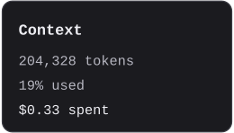

# RLS Auto-Restock

**Autonomous virtual delivery drivers for [RLS Career Overhaul](https://www.patreon.com/rlsmodding) passive businesses in BeamNG.drive.**

> ## ⚠️ Beta
> This mod is still in **BETA**. It has been battle-tested on one career (v1.3.0, BeamNG 0.40.x,
> RLS v2.8.0), but RLS Career Overhaul is a huge, fast-moving mod and edge cases will surface.
> If you uncover an issue — a broken panel, a mis-firing delivery, a save hiccup — please
> [report it](https://github.com/Grant-Visser/rls_auto_restock/issues) for a patch. Even better:
> submit a **pull request**. The [skills library](docs/skills/README.md) documents the whole
> integration, so PRs are easier than they look.

Stop driving every supply run yourself. Enable Auto-Restock on a store and a simulated virtual
driver keeps it stocked in the background — for a transparent payroll/dispatch fee on top of the
wholesale supply cost. Deliveries are always timed to arrive well before the store runs dry, so
stock levels trend upward while you do anything else.

A lightweight, standalone companion mod. It does **not** modify or repackage
`rls_career_overhaul.zip` — it reads the live store state of RLS Career Overhaul v2.8.x and
integrates through RLS's own extension points.

---

## Features

### Per-store configuration (persisted in your career save)

| Setting | Default | Meaning |
| --- | --- | --- |
| `autoRestockEnabled` | `false` (opt-in) | Virtual drivers dispatch automatically for this store |
| `restockThresholdPercent` | `0.30` | Dispatch when stock drops below 30% of capacity (presets: 25% / 50% / 75%) |
| `targetFillPercent` | `1.0` | Order enough pallets to refill to 100% of capacity |
| `driverTier` | `"standard"` | `"standard"` or `"express"` delivery tier |

Settings are stored per `businessId` inside the active RLS career save slot
(`…/career/rls_career/rlsAutoRestock.json`) and survive game restarts. In-transit deliveries
persist too: reload mid-delivery and the remaining timer finishes properly, then the stock is
credited.

### Virtual driver fee structure

Every dispatch is a real business expense, itemized before you commit:

```
totalOrderCost = wholesaleSupplyCost + driverFee

driverFee = baseDispatchFee
          + cargoSurcharge (percentage of the wholesale supply cost)
          + distanceSurcharge ($0.03 per metre depot → store, when coordinates are available)
```

| | Standard | Express |
| --- | --- | --- |
| Base dispatch fee | $150 | $300 |
| Cargo / volume surcharge | 12% of supply cost | 22% of supply cost |
| Base transit time | 45s | 20s |

Payments are posted through RLS's own economy (wallet log entry
*"Auto-restock driver order: \<supplies\>"*), and the store's own Finances tab records the order
like any manual supply purchase.

### Guaranteed-to-beat-consumption delivery timers

At dispatch time the mod reads the store's live consumption (one pallet per `cycleSeconds` while
the store is open) and computes how long the current stock will last:

```lua
timeUntilEmpty   = (stock - 1) * cycleSeconds + (cycleSeconds - cycleProgress)
deliveryDuration = math.max(5, math.min(baseDeliverySeconds, timeUntilEmpty * 0.5))
```

The transit time is clamped to **at most half of the time until the shelves empty** (floor of 5s),
so a delivery can never arrive after a sell-out. On completion the pallets are credited (clamped to
capacity), a toast notification shows the store, amount and driver fee, and the next cycle begins.

### Store Management UI integration

Each owned store's Business Computer gains an **Auto-Restock** tab (via RLS's business-type tab
manifest system — no RLS files are edited):

- Enable / disable toggle per store
- Threshold preset selector: 25% / 50% / 75%
- Driver tier selector: Standard vs Express, each showing the estimated driver fee
- Itemized fee breakdown (supply cost, base dispatch, cargo surcharge, distance surcharge, total)
- Live status badge: `Idle` · `Low stock — dispatching` · `Driver En Route (Xs)` ·
  `Insufficient funds` · `Travel to this store's map`
- Manual **Dispatch driver now** button and delivery cancel, if you want to drive the economics
  yourself

### Safety & error handling

- `onUpdate` runs only while an RLS career session is active (`overhaul_career_career.isActive()`)
  and the simulation is unpaused (`dtSim > 0`).
- Every RLS module access is guarded and `pcall`-wrapped: without RLS — or with an incompatible
  future RLS version — the mod idles and the UI tab explains why instead of erroring.
- Insufficient funds block dispatches (with a one-time toast + UI badge) instead of spamming.
- Selling a store mid-delivery cancels the delivery cleanly (paid orders are forfeited, matching
  RLS's own sale rules).

---

## Installation

1. Install **RLS Career Overhaul v2.8+** and load (or create) a career save.
2. Install this mod using **one** of these methods:

   **Zip (recommended)** — drop `rls_auto_restock.zip` into your mods folder, do **not** extract it:

   ```
   %LOCALAPPDATA%\BeamNG.drive\current\mods\rls_auto_restock.zip
   ```

   **Unpacked folder** — put the `rls_auto_restock` folder (the one containing `lua\`, `gameplay\`,
   `scripts\`, `ui\`) into:

   ```
   %LOCALAPPDATA%\BeamNG.drive\current\mods\unpacked\rls_auto_restock\
   ```

   > ⚠️ **Layout matters.** BeamNG only mounts zips whose *content sits at the zip root*, and loose
   > folders only from `mods\unpacked\`. A folder dropped directly into `mods\` is silently ignored —
   > the classic symptom is that nothing appears in game and nothing logs an error.

3. Restart BeamNG.drive completely (adding files while the game runs does not refresh the virtual
   file system), or reload the mod list from the Mod Manager.
4. In career, walk into any owned store's Business Computer and open the new **Auto-Restock** tab.
   Flip the toggle, pick a threshold and a driver tier. Done — the store restocks itself.

### Verifying it loaded

Open the console (`~`) and run:

```lua
FS:fileExists("/gameplay/overhaul/business/types/rls_auto_restock.json")
extensions.rlsAutoRestock ~= nil
```

Both should return `true`. If the first is `false`, the mod is not mounted (check the install
layout above); if the second is `false`, run `extensions.load("rlsAutoRestock")`.

> The mod only acts while a career session is running. In freeroam it sits idle.

---

## How it works (for the curious)

```
rls_auto_restock/
├── gameplay/overhaul/business/types/rls-auto-restock-tabs.json   ← adds the Auto-Restock tab to passiveBusiness computers
├── gameplay/overhaul/career/modules/rlsAutoRestock.json     ← registers the Lua module with RLS's career module loader
├── lua/ge/extensions/rlsAutoRestock.lua                     ← the engine extension (settings, fees, timers, persistence)
├── scripts/rls_auto_restock/modScript.lua                   ← loads the extension at game start
└── ui/ui-vue/mods/rls_auto_restock/ui/AutoRestockPanel.vue  ← the tab UI (loaded by BeamNG's runtime component loader)
```

Want to build your own RLS companion mod? The complete knowledge base this mod was debugged
against lives in **[docs/skills](docs/skills/README.md)** — RLS architecture, extension
patterns, business-computer tab integration, the bridge/round-trip pitfalls, and the full
debugging playbook.

- **Lua side** — RLS keeps store state (`stock`, `storageLevel`, `cycleProgress`, `wholesaleOwned`,
  `operating`) in a module-local table. The companion binds to that live table through a debug
  upvalue anchor, so stock reads/writes stay consistent with RLS's own production loop without
  touching RLS code. Supply prices, wholesale status, facility coordinates and the career wallet
  come from RLS's public modules (`overhaul_career_economy_*`, `overhaul_world_facilities`,
  `overhaul_career_logistics_generator`).
- **Persistence** — settings and in-transit timers are written to
  `<save slot>/career/rls_career/rlsAutoRestock.json` on every RLS career save
  (`onOverhaulSaveCurrentProfile`) and reloaded on career activation.
- **UI side** — the tab manifest is picked up by RLS's business-type catalog; the Vue component is
  streamed by BeamNG's official `ui/ui-vue/mods/` runtime loader and talks to the Lua bridge
  (`lua.rlsAutoRestock.*`) plus a `RlsAutoRestockStore` push event.

## Fast iteration (development, no game restarts)

Zips are only mounted at game start and are not watched. For iterating on the mod, install it
**unpacked** (one last restart to switch) and use hot reloads afterwards:

1. One-time switch: delete the zip from `mods\`, put the folder in
   `mods\unpacked\rls_auto_restock\`, restart the game once.
2. After editing files, refresh only what changed from the console (`~`):

   ```lua
   -- UI changes (any .vue / index.js / business-type manifest):
   rlsAutoRestock.reloadUI()
   -- equivalent to: guihooks.trigger("UiModsChanged")

   -- Lua extension change:
   extensions.unload("rlsAutoRestock"); extensions.load("rlsAutoRestock")

   -- everything at once:
   extensions.unload("rlsAutoRestock"); extensions.load("rlsAutoRestock"); guihooks.trigger("UiModsChanged")
   ```

3. Saving files under `mods\unpacked\` also fires the file watcher automatically, so UI changes
   often hot-reload without any command. `Ctrl+L` reloads the whole UI as a sledgehammer.

Career save data (`rlsAutoRestock.json`) is untouched by any of these - settings and in-transit
deliveries survive.

## Requirements

- BeamNG.drive **0.40.x**
- [RLS Career Overhaul](https://www.patreon.com/rlsmodding) **v2.8.x** with a career save that has
  at least one owned passive business (Mini Mart, Cafe, Boutique, Supermarket, Nail Salon,
  Gift Shop, Jewelry Store, Dry Cleaner, Specialty Retail…)

## Compatibility & notes

- Per-save settings: enabling auto-restock on one career does not affect another.
- Express is faster and pricier; the distance surcharge scales with the depot→store distance, so
  remote stores pay more per run.
- The mod never takes revenue — it only pays suppliers and drivers. Money leaves the wallet via
  RLS's normal payment pipeline (visible in the wallet history).

## Cost to make

This entire mod — code, UI, manifests, README and publishing — was built in a single AI coding session:



**204,328 tokens · 19% of the session context · $0.33 spent.** No manual coding was done by hand;
the whole companion mod was specified, built, verified and published for less than the price of a
gumball. (If you want to swap in your own screenshot, replace `docs/cost-to-make.svg`.)

## Thanks

Huge thanks to **[AR12Gaming](https://www.youtube.com/ar12gaming)** — his BeamNG career playthroughs
are what make mods like RLS Career Overhaul worth building for, and this companion mod exists to
make that series-style gameplay even smoother. Go check out his channel for BeamNG career content,
mod spotlights and more: **https://www.youtube.com/ar12gaming**

## License

MIT — see [LICENSE](LICENSE). RLS Career Overhaul is a separate mod by its respective author(s);
this companion mod ships none of its code or assets.
